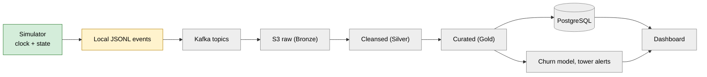
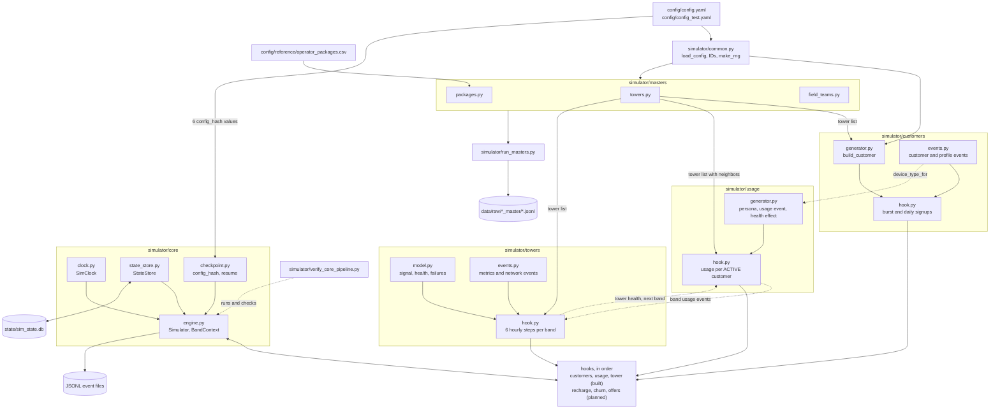

# ChurnGuard

ChurnGuard is a configurable telecom customer-churn and tower-health early-warning project. Real Pakistani telecom data is not public, so all data is synthetic and comes from one live, resumable simulator. The simulator produces reproducible master data and event streams that feed a medallion pipeline (Bronze, Silver, Gold).

## Status

| Step | What | Status |
|---|---|---|
| 1 | Setup (config, Kafka topics, S3 prefixes) | Done |
| 2 | Master data (towers, packages, field teams) | Done |
| 3 | Simulator core (clock, state store, checkpoint, engine) | Done |
| 4 | Customers, profiles and a first simple usage stream | Done |
| 5 | Tower health (tower metrics, network events, health effect on usage) | Done |
| 6-10 | Full usage rules, recharge and packages, lifecycle (churn), offers, dirty data | Planned |
| 11-13 | Kafka producer, consumers and S3, full 180-day run and checks | Planned |

After ingestion: Silver (cleansing), Gold (features), PostgreSQL, the four solutions (churn prediction, tower failure alerts, offers, complaints model), dashboard, and Docker.

Step 4 produces `customer_events`, `profile_events` and `usage_events`. Step 5 adds `tower_metrics_events` (hourly) and `network_events` (outage START and END), and tower health now changes `dropped_calls` and moves customers off a DOWN tower. The usage stream still has no spend and no packages; those come in Steps 6 and 7.

## Architecture



Green is built, yellow is in progress, grey is planned. Events are written to local JSONL first and checked; Kafka is added in Step 11. Master data (towers, packages, field teams) goes straight to S3, not through Kafka.

## How the pieces connect



- `common.py` is shared by everything: config loading, ID formats, and a seeded random generator per entity (`make_rng`), so the same entity always gets the same values.
- The master builders read the config (and the Jazz package CSV) and `run_masters.py` writes them to `data/raw/`.
- The customer generator uses the tower list to give each customer a home tower in their own city. `events.py` turns a new customer into `customer_events` and `profile_events` records. The customer hook decides how many customers sign up in each band.
- The usage generator builds one usage record per customer per band. The usage hook runs it for every ACTIVE customer and passes the previous band's tower health. Towers passed to it must come from `add_neighbors(build_towers(cfg))`, so roaming to a neighbor tower works.
- The tower model decides signal, health and failures. The tower hook runs after the usage hook, uses this band's usage events to get each tower's traffic, and writes `tower_metrics_events` and `network_events`.
- The engine combines the clock, the SQLite state store and the checkpoint, and calls hooks. Each hook returns `(topic, event)` pairs. `BandContext.band_events` lets a hook see the events of the hooks before it.

### What happens in one time band

1. Open a SQLite transaction.
2. Run each hook in order; each returns the events it produced.
   - Customer hook: signs up this band's new customers (SQLite row plus `customer_events` and `profile_events`).
   - Usage hook: one `usage_events` record per ACTIVE customer, including customers who signed up in this same band. It reads the tower health saved at the end of the previous band.
   - Tower hook: counts this band's traffic per tower from the usage events, runs six hourly steps per tower, writes `tower_metrics_events` and `network_events`, and saves the tower state.
3. Append the events to JSONL files, one file per topic.
4. Save the checkpoint (band index, next customer number) and commit the transaction.
5. Advance the clock. In live mode, wait between bands.

If a band crashes, the transaction rolls back and the band runs again. Events are deterministic (`event_id` comes from the seed), so any duplicates are removed by `event_id` downstream.

## Customer and usage model (Step 4)

**Customers.** The first `initial_burst_days` days bring `initial` customers, with a decaying shape (each day is `burst_decay` times the previous day, normalized). After that `new_per_day` customers sign up daily. A day's customers are split equally across its four bands. Customer numbers start at 1 (`C0000001`).

**Profile fields** are drawn from fixed shares set in `simulator/customers/events.py`:

| Field | Values (share) |
|---|---|
| age_band | 18-24 (25%), 25-34 (35%), 35-44 (22%), 45-54 (12%), 55+ (6%) |
| gender | male (60%), female (40%) |
| language_pref | Urdu (65%), English (25%), Regional (10%) |
| arpu_band | low, mid, high; prepaid leans low and mid (overall about 40/40/20) |
| acquisition_channel | retailer (55%), online (15%), campaign (15%), referral (10%), other (5%) |
| device_type | smartphone_android (62%), smartphone_ios (8%), feature_phone (30%) |

Phone and CNIC are masked from the start (`0334-xxxx09`, `xxxxx-xxxxx45-7`). The last CNIC digit follows gender (odd for male, even for female).

**Usage.** One record per ACTIVE customer per band:

- Each customer gets a persona from their device: feature phones are `call_heavy` or `sms_heavy` with almost no data; smartphones are `call_heavy`, `whatsapp_only` or `data_heavy`. The persona sets the daily average of on-net, off-net and international minutes, SMS and data (split into WhatsApp, social, video, browsing and other).
- A fixed per-customer factor (0.5x to 1.8x) and a per-band noise (about plus or minus 25%) make customers differ. A day's use is split across the bands as Night 10%, Morning 30%, Afternoon 25%, Evening 35%.
- In 85% of bands the customer is on the home tower, otherwise on one of its three neighbor towers (same city). If the chosen tower is DOWN, the customer uses the home tower or a neighbor that is not DOWN; in a city with one tower the customer stays on the DOWN tower.
- `dropped_calls`: calls are estimated as minutes divided by 3, and each call drops with a base chance of 1.5% on a healthy tower. This chance is multiplied by 3 (DEGRADED), 8 (CRITICAL) or 20 (DOWN).
- `active_package_ids` is an empty list and `spend_from_package` and `spend_from_balance` are null until Step 7.

## Tower health model (Step 5)

Each tower has a signal (dBm) and a health state: HEALTHY (above -95 dBm), DEGRADED (-95 to -105), CRITICAL (below -105) or DOWN. A healthy tower can:

- fail suddenly (0.01% per hour), with no warning;
- fail slowly: the signal falls in a straight line over 1 to 7 days, then the tower goes DOWN;
- have a short dip of 2 to 8 hours that recovers by itself (a false alarm, 5 times more likely when load is above 1.0).

DOWN lasts 3 to 12 hours. Load is the band's real traffic (`active_users` from usage events divided by the tower's `capacity_users`), split over six hours with fixed weights. The hidden state (`precursor_active`, `failure_at`) stays in SQLite and is never published. Full details and numbers: `docs/core/step5_tower_health.md`.

## Project structure

```text
config/                 Runtime and test configuration; reference inputs
  reference/            Jazz package CSV and its source note
data/                   Generated output (git-ignored)
  raw/                  Generated master-data output
  reference/            Source snapshots used during development
  test_run*/            Output of the verification script
docs/                   Project, schema, and data-flow documentation
  core/                 Simulator core and tower health notes
  master/               Master-data summary and data flow
  schema/               Event schemas (event_schemas.md)
  tools/                Package-data scraping notes
simulator/
  core/                 Four-band clock, simulation engine, checkpoints, state store
  customers/            Customer generator, customer and profile events, signup hook
  usage/                Usage generator and usage hook
  towers/               Tower health model, hourly and outage events, tower hook
  masters/              Tower, package, and field-team master builders
  common.py             Shared config, ID, and random-seed helpers
  run_masters.py        Master-data generation entry point
  verify_core_pipeline.py   End-to-end check of the customer, usage and tower hooks
state/                  SQLite runtime state (git-ignored)
tests/                  Automated tests
tools/                  Source-checking and package-data scripts
```

## Key design rules

- **Time:** the simulated clock moves in four six-hour bands per day (Night, Morning, Afternoon, Evening). History runs fast (backfill, 180 days), then the simulator can continue live. Tower state uses an hour index (band index x 6 + hour).
- **Events vs state:** events are the real data and go to JSONL, then Kafka, then S3. The SQLite state store only remembers what the simulator needs to continue (balances, packages, status, tower state, the current band) and keeps no history. Do not delete `state/` during a run.
- **Reproducible:** a fixed seed plus a per-entity random generator, so adding customers or towers later does not change existing ones.
- **Resumable:** a restart continues from the saved band. The verification script stops a run midway and checks that the resumed output matches a full run.
- **Config fingerprint:** `seed`, `start_date`, and the four `ids` values form a `config_hash`. If any of these change after a run has started, the simulator stops instead of mixing old and new data. Scale settings (customers, history days, rates) can change.
- **No zone or city copies:** `customer_events` has no `zone`, and SQLite has no `city` column. A customer's connected tower changes from band to band, so zone and city come from the tower (`tower_id` joined to the tower master).
- **Shared device type:** `device_type_for(cfg, n)` gives the same device every time, so the customer event and the usage generator always agree.
- **Hidden ground truth:** at-risk state, churn reasons, and the tower failure state (`precursor_active`, `failure_at`) are never published as events or model features.
- **Tower traffic is real:** tower load comes from the band's usage events, not from a guess. Tower failures reach usage one band later. DOWN hours have no tower metrics event, so tower totals are not equal to totals taken from usage events.

## Setup

From the project root in PowerShell:

```powershell
python -m venv venv
.\venv\Scripts\Activate.ps1
python -m pip install -r requirements.txt
```

## Run

Generate master data using the main configuration:

```powershell
python -m simulator.run_masters --config config.yaml
```

Use the smaller configuration for a test-sized master-data run:

```powershell
python -m simulator.run_masters --config config_test.yaml
```

Run the test suite:

```powershell
python -m pytest tests -v
```

Run the end-to-end check of the customer, usage and tower hooks (test config; it writes only to `data/test_run*` and `state/test_sim*.db` and deletes them first):

```powershell
python -m simulator.verify_core_pipeline
```

It runs the simulator three times (normal, same seed again, stopped and resumed) and prints PASS or FAIL for nine checks: same seed gives the same events (all five topics), resume matches a full run, counts are right, every event has the common envelope, phone and CNIC are masked, there is no `zone` in `customer_events` and usage points to known customers and towers, every tower hour is either a metrics event or a DOWN hour, tower health values and START/END pairs are correct and no hidden state leaks into events, and tower `dropped_calls` is not more than the usage total. The script raises the failure rates for its own run so that the short test has outages; the real constants in `simulator/towers/model.py` do not change.

Master-data output is written under `data/raw/`. There is no command yet to run the full 180-day simulator; the engine runs from the tests and the verification script until the recharge, churn, offers and dirty-data hooks are added in Steps 6 to 10.

## Configuration

`config/config.yaml` is the real configuration and `config/config_test.yaml` is a small one for tests (5 days, 100 customers, 1 to 3 towers per city).

| Section | What it controls |
|---|---|
| `seed`, `start_date`, `history_days` | Reproducibility and the simulated time range |
| `ids` | ID prefixes and widths (customers `C0000001`, towers `T01001`) |
| `customers` | Initial burst, burst length and decay (`burst_decay`), new customers per day, prepaid share |
| `geography` | Eight cities: customer share, towers, field teams |
| `churn`, `towers` | Churn target and timings; tower health thresholds (`critical_load`, signal thresholds, `failure_precursor_share`) |
| `dirty_data` | Deliberate nulls, duplicates, and late events |
| `kafka`, `s3` | Connection and batching settings |

The profile shares, persona tables and usage constants live in code (`simulator/customers/events.py` and `simulator/usage/generator.py`), and the tower model constants (failure rates, durations, signal levels, hourly weights) live in `simulator/towers/model.py` and `simulator/towers/hook.py`, not in the config.

## Documentation

- `docs/schema/event_schemas.md`: event and master schemas, Kafka keys, S3 partitions
- `docs/core/step3_simulator_core.md`: simulator core design
- `docs/core/step5_tower_health.md`: tower health design and numbers
- `docs/master/`: master-data summary and data flow
- `docs/tools/`: how the Jazz package data was collected