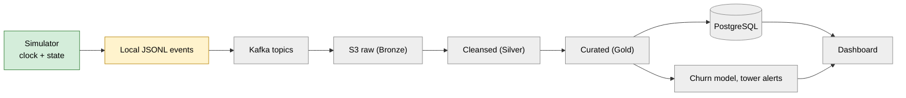
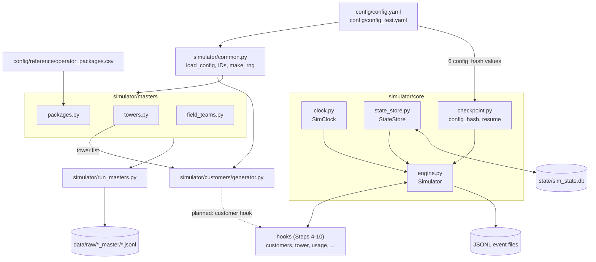

# ChurnGuard

ChurnGuard is a configurable telecom customer-churn and tower-health early-warning project. Real Pakistani telecom data is not public, so all data is synthetic and comes from one live, resumable simulator. The simulator produces reproducible master data and event streams that feed a medallion pipeline (Bronze, Silver, Gold).

## Status

| Step | What | Status |
|---|---|---|
| 1 | Setup (config, Kafka topics, S3 prefixes) | Done |
| 2 | Master data (towers, packages, field teams) | Done |
| 3 | Simulator core (clock, state store, checkpoint, engine) | Done |
| 4 | Customers and profiles | In progress (customer generator done) |
| 5-10 | Tower health, usage, recharge and packages, lifecycle (churn), offers, dirty data | Planned |
| 11-13 | Kafka producer, consumers and S3, full 180-day run and checks | Planned |

After ingestion: Silver (cleansing), Gold (features), PostgreSQL, the four solutions (churn prediction, tower failure alerts, offers, complaints model), dashboard, and Docker.

## Architecture



Green is built, yellow is in progress, grey is planned. Events are written to local JSONL first and checked; Kafka is added in Step 11. Master data (towers, packages, field teams) goes straight to S3, not through Kafka.

## How the pieces connect



- `common.py` is shared by everything: config loading, ID formats, and a seeded random generator per entity (`make_rng`), so the same entity always gets the same values.
- The master builders read the config (and the Jazz package CSV) and `run_masters.py` writes them to `data/raw/`.
- The customer generator uses the tower list to give each customer a home tower in their own city.
- The engine combines the clock, the SQLite state store and the checkpoint, and calls hooks. Each hook returns `(topic, event)` pairs. The customer hook (Step 4) and the later hooks plug in here.

### What happens in one time band

1. Open a SQLite transaction.
2. Run each hook in order; each returns the events it produced.
3. Append the events to JSONL files, one file per topic.
4. Save the checkpoint (band index, next customer number) and commit the transaction.
5. Advance the clock. In live mode, wait between bands.

If a band crashes, the transaction rolls back and the band runs again. Events are deterministic (`event_id` comes from the seed), so any duplicates are removed by `event_id` downstream.

## Project structure

```text
config/                 Runtime and test configuration; reference inputs
  reference/            Jazz package CSV and its source note
data/                   Generated output (git-ignored)
  raw/                  Generated master-data output
  reference/            Source snapshots used during development
docs/                   Project, schema, and data-flow documentation
  core/                 Simulator core notes
  master/               Master-data summary and data flow
  schema/               Event schemas (event_schemas.md)
  tools/                Package-data scraping notes
simulator/
  core/                 Four-band clock, simulation engine, checkpoints, state store
  customers/            Customer generator
  masters/              Tower, package, and field-team master builders
  common.py             Shared config, ID, and random-seed helpers
  run_masters.py        Master-data generation entry point
state/                  SQLite runtime state (git-ignored)
tests/                  Automated tests
tools/                  Source-checking and package-data scripts
```

## Key design rules

- **Time:** the simulated clock moves in four six-hour bands per day (Night, Morning, Afternoon, Evening). History runs fast (backfill, 180 days), then the simulator can continue live.
- **Events vs state:** events are the real data and go to JSONL, then Kafka, then S3. The SQLite state store only remembers what the simulator needs to continue (balances, packages, status, the current band) and keeps no history. Do not delete `state/` during a run.
- **Reproducible:** a fixed seed plus a per-entity random generator, so adding customers or towers later does not change existing ones.
- **Resumable:** a restart continues from the saved band.
- **Config fingerprint:** `seed`, `start_date`, and the four `ids` values form a `config_hash`. If any of these change after a run has started, the simulator stops instead of mixing old and new data. Scale settings (customers, history days, rates) can change.
- **Hidden ground truth:** at-risk state and churn reasons are never published as model features.

## Setup

From the project root in PowerShell:

```powershell
python -m venv venv
.\venv\Scripts\Activate.ps1
python -m pip install -r requirements.txt
```

## Run

Generate master data using the main configuration:

```powershell
python -m simulator.run_masters --config config.yaml
```

Use the smaller configuration for a test-sized master-data run:

```powershell
python -m simulator.run_masters --config config_test.yaml
```

Run the test suite:

```powershell
python -m pytest tests -v
```

Master-data output is written under `data/raw/`. There is no command yet to run the full simulator; the engine runs from tests until the customer, tower, and usage hooks are added in Steps 4 to 10.

## Configuration

`config/config.yaml` is the real configuration and `config/config_test.yaml` is a small one for tests (a few days, 100 customers, 1 to 3 towers per city).

| Section | What it controls |
|---|---|
| `seed`, `start_date`, `history_days` | Reproducibility and the simulated time range |
| `ids` | ID prefixes and widths (customers `C0000001`, towers `T01001`) |
| `customers` | Initial burst, new customers per day, prepaid share |
| `geography` | Eight cities: customer share, towers, field teams |
| `churn`, `towers` | Churn target and timings; tower health thresholds |
| `dirty_data` | Deliberate nulls, duplicates, and late events |
| `kafka`, `s3` | Connection and batching settings |

## Documentation

- `docs/schema/event_schemas.md`: event and master schemas, Kafka keys, S3 partitions
- `docs/core/step3_simulator_core.md`: simulator core design
- `docs/master/`: master-data summary and data flow
- `docs/tools/`: how the Jazz package data was collected